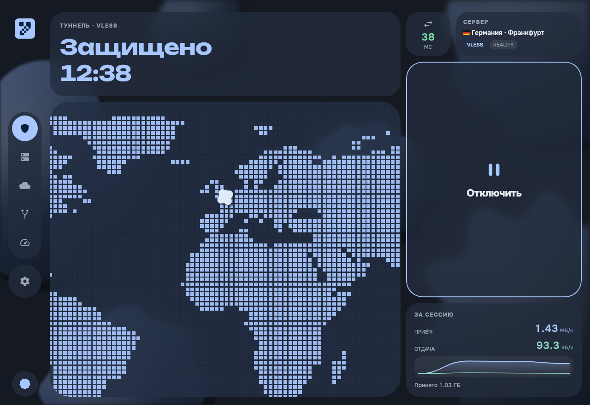
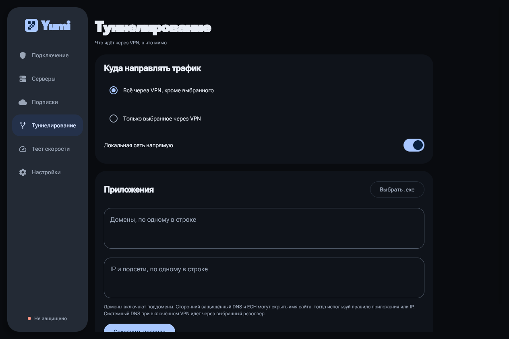
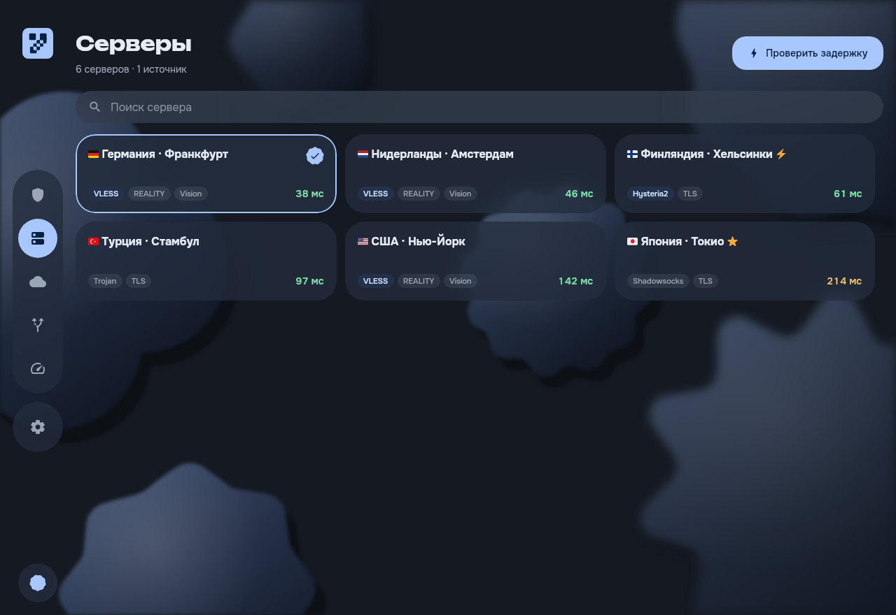
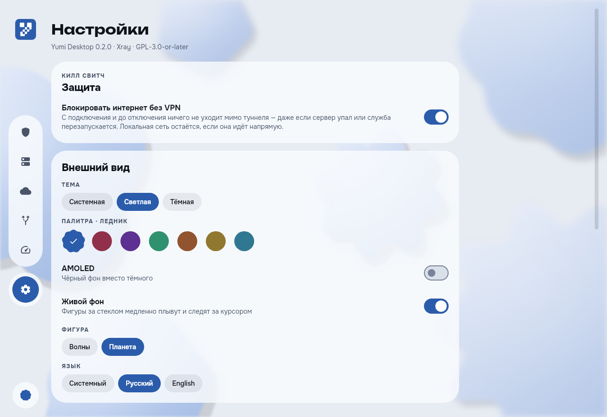

# Yumi Desktop

[English](README.md) · [Русский](README.ru.md)

> The tunnel service runs with system privileges; its responsibilities and access controls
> are described below.

The Windows port of Yumi — a VPN client for Xray-family servers — dressed in the matte glass of
its sister app YouCloud: Material 3 Expressive shapes drift behind the window, every panel is frosted
glass over them, and dragging the window knocks them about on springs.

* **Connect screen** — a poster headline that says what the tunnel is doing, a figure that shows
  what it is carrying (a scrolling pixel map of the world, or the traffic waves), and one loud
  control beside it.
* **Servers** — a readable list with protocol/transport details, source, selection and latency
  aligned in each row. Connecting measures the active tunnel immediately. Ping measures only the current search results; the search survives page navigation. Server rows never change by themselves. Happ auto-select rows keep all their members and follow the provider's cost/fastest policy, as on mobile.
* **Tray** — one click restores the window; the menu switches servers, shows their ping and
  refreshes latency without opening the app.
* **Connection health** — protection is shown after the tunnel carries a verified request.
  An unreachable server is reported even when the local core is still running; checks continue
  until it recovers.
* **Subscriptions** — quota, expiry and refresh, or a QR transfer from Yumi on your phone over the
  local network.
* **Split tunnelling** — pick applications from what is running and installed, with their icons, or
  type a process name the way Clash takes one; domains and subnets either direction.
* **Russian sites directly** — the geoip/geosite databases, fetched by the service on its own, send
  Russian sites around the tunnel *above* the application rules: a browser sent wholly through the
  VPN still opens them directly. YouTube stays in the tunnel.
* **Kill switch** — from connect until disconnect nothing leaves around the tunnel, even when the
  server or the core falls over.
* **Location as the server's (for Claude and other geo-strict services)** — while connected,
  Yumi can hide your real whereabouts beyond the exit IP: the system timezone moves onto the
  selected server's country (and follows live server switches), OS location sources go quiet
  (`lfsvc` and policies on Windows, `GeoClue` on Linux, `locationd` on macOS), DNS queries are
  locked to the tunnel, and IPv6 stays blackholed when off — giving sites and apps like Claude a
  consistent IP, clock and location signal. Off until enabled in Settings; everything is written to
  a snapshot first and restored on disconnect or after a crash. Does not synthesize GPS coordinates
  or erase a browser's cached location. See [Hiding your real location](#hiding-your-real-location).
* **Speed test** — a dial and a live trace, through the tunnel or around it.
* **Fifteen palettes**, light and dark, plus AMOLED black; Unbounded and Onest, as in YouCloud.
* **Connect on launch**, optionally, to the server you selected; off until you enable it in Settings.
* **Updates in Settings** — background checks and verified downloads, progress and cancellation,
  then restart now or install on exit. Each platform asks its own permission to replace the app
  and service.

| | |
|:-:|:-:|
|  |  |
|  |  |

Taken with `--ui-demo`, which seeds made-up servers and runs every screen against a stand-in for the
service that pretends to connect.

Protocols come from Xray: VLESS (including REALITY and Vision), VMess, Trojan, Shadowsocks,
Hysteria2, TUIC and the rest of the outbound catalogue, over TCP, WebSocket, gRPC, HTTP/2,
HTTPUpgrade or QUIC.

## Requirements

Windows 10 version 1809 (build 17763) or newer, 64-bit. Nothing else: the installer brings its own
Java runtime and its own network adapter driver.

Linux (x86-64, systemd; `.deb` and `.rpm`) and macOS 12 or newer on Apple Silicon (`.dmg` to
install, `.pkg` for the updater) carry the same feature set: the tunnel, the kill switch, split
tunnelling, the geo databases, subscriptions, the location mode. See [Linux and macOS](#linux-and-macos).

## Installing

Run `Yumi-Desktop-<version>-windows-x64-setup.exe` and accept the elevation prompt. The installer:

1. copies the application into `Program Files\Yumi Desktop`;
2. registers `YumiTunnel`, the Windows service that owns the tunnel, and starts it;
3. adds one inbound firewall rule, scoped to the local subnet on private and public networks, so a phone can
   hand a subscription over by QR.

The installer is not code-signed, so SmartScreen will offer to protect you from it. "More info"
then "Run anyway" is the way past that.

Uninstalling removes the service, the firewall rule and the startup entry. Your subscriptions and
settings live in `%LOCALAPPDATA%\YumiDesktop` and are left alone, so reinstalling keeps them; delete
that folder by hand if you want them gone.

## Linux and macOS

Install the package the distribution's way — `dpkg -i`, `rpm -U`, or a double-click for the macOS
dmg — and start Yumi. The tunnel service is not registered at install time: the first connection
asks once for the administrator password (`pkexec` on Linux, the administrator dialog on macOS),
registers `yumi-tunnel.service` with systemd or the daemon with launchd, and from then on the
service owns the tunnel exactly as `YumiTunnel` does on Windows — same protocol, same commands,
a unix socket at `/run/yumi/tunnel.sock` in place of the named pipe. The privileged binary is copied into `/usr/local/libexec/yumi-desktop` on Linux or `/Library/PrivilegedHelperTools` on macOS, independent of the app bundle. Updating the app also reinstalls/restarts that helper.

* The **kill switch** is an nftables table on Linux and a pf anchor on macOS, installed before the
  core starts and removed on disconnect. It permits the service's own account rather than one
  executable — nftables and pf match owners, not programs — so other root processes ride free
  alongside the tunnel; user-level traffic, which is what the shield exists to hold, does not.
* macOS uses its existing `com.apple/*` PF anchor hook; a custom ruleset without that hook is reported as unsupported rather than replaced. Enabling the kill switch clears pre-existing PF states once; hot replacements preserve current flows.
* The **system resolver** is pointed into the tunnel while it is up (`resolvectl` where
  systemd-resolved runs, `/etc/resolv.conf` with a kept copy where it does not, `networksetup` on
  macOS) and given back on the way out. The baseline is stored before the first change and restored after partial failures or a crashed worker as well.
* **Location as the server's** moves the clock with `timedatectl` or `systemsetup` and silences
  GeoClue or locationd, restoring both from the written-down snapshot.
* Packages are not code-signed. macOS asks Gatekeeper about the first launch: right-click the
  application, "Open". The Application Firewall may ask once about incoming connections for the
  subscription transfer; that is the phone handing a subscription over.

Honest limits: the tray icon needs an AppIndicator-compatible shell (GNOME without the extension
reports none, and closing the window then quits the app instead of hiding it — the app says so and
behaves accordingly), and the macOS build is Apple Silicon only.

## How it is split

The application never touches the network stack. It talks to a local service over a named pipe,
and the service is the only thing that holds the tunnel:

| Module     | What it is                                                                   |
|------------|------------------------------------------------------------------------------|
| `desktop`  | The Compose UI, the window, the tray icon.                                    |
| `logic`    | Parsing, subscriptions, latency and speed measurement, the Xray config. Shared, unchanged, with the Android app. |
| `platform` | The OS-shaped parts: the registry, the named pipe and its unix twin, the title-bar colour, the application catalog. |
| `service`  | The Go service: the tunnel adapter, Xray-core, and the command protocol. Runs as `YumiTunnel` on Windows, as `yumi-tunnel` under systemd or launchd elsewhere. |

The service accepts commands from exactly one account — the owner's SID on Windows, the owner's uid
on Linux and macOS, baked into its configuration — and does nothing at all until the application
asks it to connect.

That account is the one that was signed in when the installer ran, not the one that answered the
elevation prompt. On a machine where those differ, the service would otherwise be owned by an
administrator who never opens Yumi, and the person who does would be refused by a service that
`services.msc` reports as running perfectly. If it happens anyway — the account was renamed, or a
second person uses the machine — the connect screen says so in as many words and offers to
re-register the service, which costs one elevation prompt.

The firewall rule covers the public network profile as well as the private one, and stays scoped
to the local subnet. Private-only is the safer setting on paper and it made subscription transfer
not exist on laptops: Windows marks a new Wi-Fi network public by default, so the rule never
applied and the phone's connection was dropped without a word. The domain profile is deliberately
left out.

Switching servers keeps the forwarding stack alive and reconnects VPN flows through the selected
server. Existing direct connections are preserved. The session timer and traffic totals
continue across the switch. Turning VPN off cancels VPN connections and sends new traffic directly;
the adapter stays up as a direct forwarding stack so excluded applications keep their existing
sockets. Stopping the Windows service removes the adapter's routes and closes that stack.
Changing routing, DNS, MTU, IPv6 or the physical adapter still requires rebuilding it. A connection
whose remote server has died cannot be transferred to another server without reconnecting.

Tunnel settings are applied on the first connection and immediately after a saved change. Changes
saved while connecting are applied once the worker starts. On Windows, a separate dynamic WFP
session restricts TCP/UDP DNS to the tunnel resolver, even with kill switch off and LAN bypass on.
It prevents physical-adapter DNS fallback and clears the system DNS cache when enabled or removed.
The restriction is removed when VPN is turned off or the worker exits; physical-adapter settings
are not rewritten. Browser-managed encrypted DNS follows the browser's own settings and routing.

### Kill switch

With the kill switch on, the service installs Windows Filtering Platform filters the moment you
connect: everything is blocked except the tunnel adapter, the service itself (which carries the
tunnel and whatever it routes around it), loopback, DHCP and — when "local network directly" is on
— the private ranges, so printers and the phone transfer keep working. The filters stay through a
crashed core or a dropped server and come down only when you disconnect. They live in a dynamic
session, so if the service itself dies Windows removes them: a crash can cost you the kill switch,
never the network.

### Hiding your real location

Services with strict region checks — such as Claude — often look past your IP address to the
system clock's timezone, OS location APIs (Wi-Fi triangulation), DNS leaks and IPv6 traffic. Yumi
combines **Match the server's location** (Settings → Protection, off by default) with the tunnel's
built-in leak protections:

* **System timezone matching** — reads the two-letter country code from the flag in the selected
  server's name and sets the matching timezone via `tzutil` (Windows), `timedatectl` (Linux) or
  `systemsetup` (macOS) once connected. Hot-switching to a server in another country updates the
  timezone live without restarting the tunnel; servers without a flag keep the current clock while
  still silencing location sources. Settings displays the active system timezone.
* **Silencing OS location sources** — prevents apps and browsers from obtaining a Wi-Fi or
  network-triangulated fix while connected:
  * **Windows**: sets `DisableLocation` and `DisableWindowsLocationProvider` under
    `HKLM\SOFTWARE\Policies\Microsoft\Windows\LocationAndSensors` and stops `lfsvc`.
  * **Linux**: runtime-masks and stops `geoclue.service`.
  * **macOS**: disables and unloads `com.apple.locationd`.
* **Crash-safe snapshot and restore** — before making any change, the service writes a snapshot
  (`sysstate.json`, recording the previous timezone, policy values/types/absence and location
  service state) and persists its target timezone intent prior to switching the clock. Disconnects,
  worker exits and service restarts after a crash restore the exact prior state without overwriting
  pre-existing administrator policies or already-disabled services.
* **DNS and IPv6 leak protection** — tunnel DNS queries go through the configured resolver (DoH
  `https://1.1.1.1/dns-query` by default, or TCP/UDP/IP). On Windows, a dynamic WFP session blocks
  TCP/UDP port 53 to every resolver except the tunnel (`172.31.255.2`), stopping physical-adapter
  or router DNS fallback even with the kill switch off and LAN bypass on, and flushes the Windows
  DNS cache. On Linux and macOS, the system resolver is redirected into the tunnel and restored from
  a snapshot. When IPv6 is disabled (the default), Xray omits IPv6 tunnel routes and blackholes
  `::/0`.
* **Clean server switches and routing overrides** — switching servers closes existing VPN flows so
  open browsers and apps reconnect through the new exit node, while kill switch (optional) keeps
  traffic inside the tunnel across core drops and custom domain rules override the Russian-site
  bypass list.

Honest limits: this mode does not synthesize fake GPS coordinates, alter browser fingerprints or
clear location data and cookies already cached by a browser, and browser-managed encrypted DNS
follows the browser's own settings and routing rules.

### Routing databases

`geoip.dat` and `geosite.dat` come from the v2fly releases Yumi on the phone uses. The service
downloads them itself — the app only asks, it never names a URL or a path — verifies the published
checksum, and keeps them in `%ProgramData%\Yumi Desktop\geo`, which only SYSTEM and administrators
can write. They are fetched the first time they are missing and again whenever you press the
button. Until they arrive the rule is silent and nothing else changes.

Rules apply in this order: the domains and subnets you typed, then the databases, then the
applications, then the default. A site you named outranks the databases, so one Russian site can be
sent back through the VPN; the databases outrank the applications.

When a tunnel will not start, what the worker said on its way down is in
`%ProgramData%\Yumi Desktop\worker.log` — a Go panic, a Wintun driver that would not load, the
core's own complaint. The file is truncated rather than rotated once it passes a megabyte.

## Building

You need a JDK 21, Go 1.26 and the two verified downloads that `bootstrap.ps1` fetches (Wintun and
Inno Setup). Then:

```powershell
$env:JAVA_HOME = 'C:\path\to\jdk-21'
./tools/bootstrap.ps1                 # once: Wintun and the installer compiler
./tools/build.ps1 -GoExe 'C:\path\to\go1.26\bin\go.exe'
```

`build.ps1` runs the JVM and Go test suites, builds the service, builds the application image,
collects every dependency's licence, compiles the installer into `dist/` and prints its SHA-256.
Pass `-SkipTests` when you are iterating.

To run the application alone, without the service — every screen works, only connecting does not:

```powershell
./gradlew.bat :desktop:run
```

`./gradlew.bat :desktop:run --args="--ui-smoke"` walks every screen in both themes and writes
screenshots to `.local/screenshots`, against a stub service that can never connect;
`--ui-demo` does the same with made-up servers and a stand-in service that pretends to connect. Add `--ui-idle` to keep it disconnected, `--ui-size=680x600` to
check the compact layout, or `--ui-resize` to capture both layout transitions. The six pages share
a header grid and fixed, separate navigation islands; a compact window gives half the width above
the map to the connection control.

`--ui-preview` opens an interactive demo without the screenshot tour. `--ui-benchmark` uses 600
made-up servers and measures actual Direct3D window renders: the planet, waves, two scroll speeds,
frozen backdrop and tray. Results go to `desktop/.local/performance/benchmark.tsv` when run via
Gradle. These modes use isolated data and never connect the real tunnel. See
[`docs/performance.md`](docs/performance.md) for the earlier Windows comparison and
[`docs/ui-performance-2026-11-13.md`](docs/ui-performance-2026-11-13.md) for the current layout,
rendering changes, checks and measurement limits.

Automatic updates run in packaged builds: a check after 15 seconds and every four hours. Installed
copies download the newest numeric Windows release (including Yumi's published betas), verify its
size and published SHA-256, and offer installation. **Update automatically** controls background
checks/downloads and installation on exit; manual checks remain available. A development or portable
copy offers the release page. Profiles and settings stay in their existing data directory.

For appearance and resume checks, `:desktop:run --args="--ui-demo --ui-resume --ui-palettes"`
hides and restores the window with the waves visualizer, then captures every palette in light,
dark and AMOLED modes. See `TODO.md` for the requested work and its verification status.

Every push builds the installer on GitHub Actions (`.github/workflows/installer.yml`) exactly as
`build.ps1` does, tests included, and keeps it as a workflow artifact. Pushing a tag `v<version>`
also attaches it, with its SHA-256, to a draft release.

## Licence

GPL-3.0-or-later; see `LICENSE`. Everything else that ships is listed in `THIRD_PARTY.md`.
