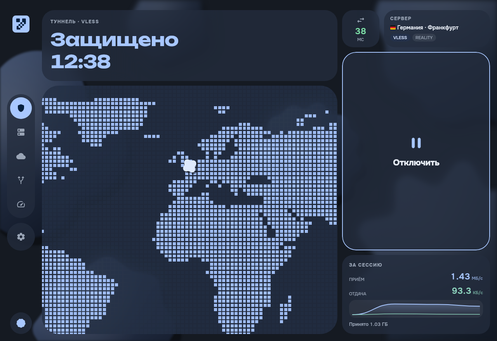
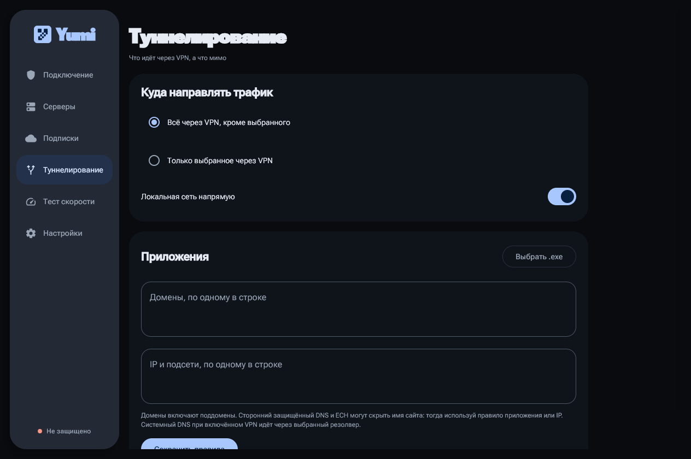
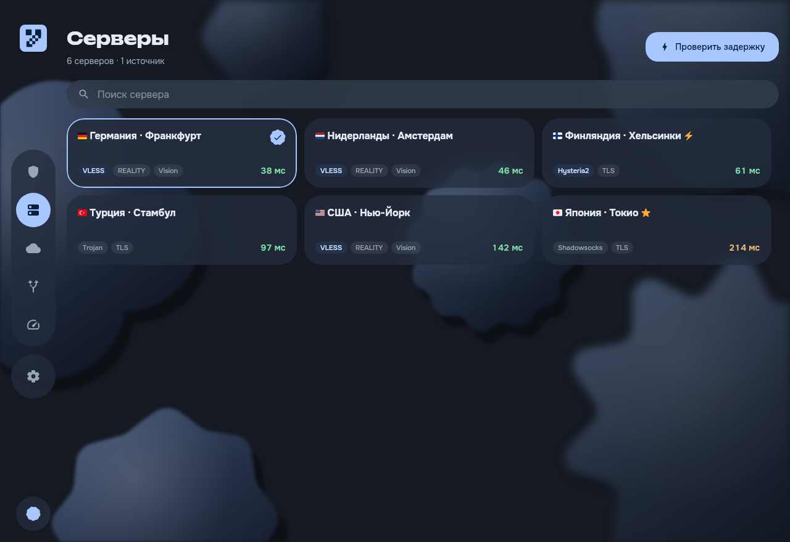
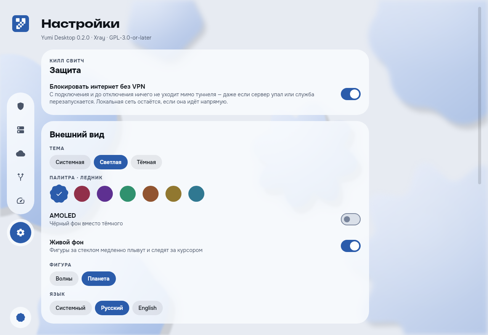

# Yumi Desktop

> **Beta.** It works, it is used daily, and it has not been through many hands yet. The tunnel
> service runs with system privileges, so read what it does below before you install it, and
> expect the rough edges of something young.

The Windows port of Yumi — a VPN client for Xray-family servers — dressed in the matte glass of
its sister app YouCloud: Material 3 Expressive shapes drift behind the window, every panel is frosted
glass over them, and dragging the window knocks them about on springs.

* **Connect screen** — a poster headline that says what the tunnel is doing, a figure that shows
  what it is carrying (a scrolling pixel map of the world, or the traffic waves), and one loud
  control beside it.
* **Servers** — a grid of glass cards with the protocol, the transport details that actually change
  behaviour, and a latency reading you can act on. The server never changes by itself.
* **Subscriptions** — quota, expiry and refresh, or a QR transfer from Yumi on your phone over the
  local network.
* **Split tunnelling** — pick applications from what is running and installed, with their icons, or
  type a process name the way Clash takes one; domains and subnets either direction.
* **Russian sites directly** — the geoip/geosite databases, fetched by the service on its own, send
  Russian sites around the tunnel *above* the application rules: a browser sent wholly through the
  VPN still opens them directly. YouTube stays in the tunnel.
* **Kill switch** — from connect until disconnect nothing leaves around the tunnel, even when the
  server or the core falls over.
* **Speed test** — a dial and a live trace, through the tunnel or around it.
* **Seven palettes**, light and dark, plus AMOLED black; Unbounded and Onest, as in YouCloud.
* **Connect on launch**, optionally, to the server you selected; off until you enable it in Settings.
* **Updates in Settings** — background checks and verified downloads, progress and cancellation,
  then restart now or install on exit. Windows asks for permission to replace the app and service.

| | |
|:-:|:-:|
|  |  |
|  |  |

Taken with `--ui-demo`, which seeds made-up servers and runs every screen against a stand-in for the
service that pretends to connect.

Protocols come from Xray: VLESS (including REALITY and Vision), VMess, Trojan, Shadowsocks,
Hysteria2, TUIC and the rest of the outbound catalogue, over TCP, WebSocket, gRPC, HTTP/2,
HTTPUpgrade or QUIC.

## Requirements

Windows 10 version 1809 (build 17763) or newer, 64-bit. Nothing else: the installer brings its own
Java runtime and its own network adapter driver.

## Installing

Run `Yumi-Desktop-<version>-windows-x64-setup.exe` and accept the elevation prompt. The installer:

1. copies the application into `Program Files\Yumi Desktop`;
2. registers `YumiTunnel`, the Windows service that owns the tunnel, and starts it;
3. adds one inbound firewall rule, scoped to the local subnet on private and public networks, so a phone can
   hand a subscription over by QR.

The installer is not code-signed, so SmartScreen will offer to protect you from it. "More info"
then "Run anyway" is the way past that.

Uninstalling removes the service, the firewall rule and the startup entry. Your subscriptions and
settings live in `%LOCALAPPDATA%\YumiDesktop` and are left alone, so reinstalling keeps them; delete
that folder by hand if you want them gone.

## How it is split

The application never touches the network stack. It talks to a local service over a named pipe,
and the service is the only thing that holds the tunnel:

| Module     | What it is                                                                   |
|------------|------------------------------------------------------------------------------|
| `desktop`  | The Compose UI, the window, the tray icon.                                    |
| `logic`    | Parsing, subscriptions, latency and speed measurement, the Xray config. Shared, unchanged, with the Android app. |
| `platform` | The Windows-shaped parts: the registry, the named pipe, the title-bar colour. |
| `service`  | The Go service: Wintun, Xray-core, and the pipe protocol. Runs as `YumiTunnel`. |

The service accepts commands from exactly one Windows account — the owner's SID is baked into its
configuration — and does nothing at all until the application asks it to connect.

That account is the one that was signed in when the installer ran, not the one that answered the
elevation prompt. On a machine where those differ, the service would otherwise be owned by an
administrator who never opens Yumi, and the person who does would be refused by a service that
`services.msc` reports as running perfectly. If it happens anyway — the account was renamed, or a
second person uses the machine — the connect screen says so in as many words and offers to
re-register the service, which costs one elevation prompt.

The firewall rule covers the public network profile as well as the private one, and stays scoped
to the local subnet. Private-only is the safer setting on paper and it made subscription transfer
not exist on laptops: Windows marks a new Wi-Fi network public by default, so the rule never
applied and the phone's connection was dropped without a word. The domain profile is deliberately
left out.

### Kill switch

With the kill switch on, the service installs Windows Filtering Platform filters the moment you
connect: everything is blocked except the tunnel adapter, the service itself (which carries the
tunnel and whatever it routes around it), loopback, DHCP and — when "local network directly" is on
— the private ranges, so printers and the phone transfer keep working. The filters stay through a
crashed core or a dropped server and come down only when you disconnect. They live in a dynamic
session, so if the service itself dies Windows removes them: a crash can cost you the kill switch,
never the network.

### Routing databases

`geoip.dat` and `geosite.dat` come from the v2fly releases Yumi on the phone uses. The service
downloads them itself — the app only asks, it never names a URL or a path — verifies the published
checksum, and keeps them in `%ProgramData%\Yumi Desktop\geo`, which only SYSTEM and administrators
can write. They are fetched the first time they are missing and again whenever you press the
button. Until they arrive the rule is silent and nothing else changes.

Rules apply in this order: the domains and subnets you typed, then the databases, then the
applications, then the default. A site you named outranks the databases, so one Russian site can be
sent back through the VPN; the databases outrank the applications.

When a tunnel will not start, what the worker said on its way down is in
`%ProgramData%\Yumi Desktop\worker.log` — a Go panic, a Wintun driver that would not load, the
core's own complaint. The file is truncated rather than rotated once it passes a megabyte.

## Building

You need a JDK 21, Go 1.26 and the two verified downloads that `bootstrap.ps1` fetches (Wintun and
Inno Setup). Then:

```powershell
$env:JAVA_HOME = 'C:\path\to\jdk-21'
./tools/bootstrap.ps1                 # once: Wintun and the installer compiler
./tools/build.ps1 -GoExe 'C:\path\to\go1.26\bin\go.exe'
```

`build.ps1` runs the JVM and Go test suites, builds the service, builds the application image,
collects every dependency's licence, compiles the installer into `dist/` and prints its SHA-256.
Pass `-SkipTests` when you are iterating.

To run the application alone, without the service — every screen works, only connecting does not:

```powershell
./gradlew.bat :desktop:run
```

`./gradlew.bat :desktop:run --args="--ui-smoke"` walks every screen in both themes and writes
screenshots to `.local/screenshots`, against a stub service that can never connect;
`--ui-demo` does the same with made-up servers and a stand-in service that pretends to connect.

`--ui-preview` opens an interactive demo without the screenshot tour. `--ui-benchmark` uses 600
made-up servers and measures actual Direct3D window renders: the planet, waves, two scroll speeds,
frozen backdrop and tray. Results go to `desktop/.local/performance/benchmark.tsv` when run via
Gradle. These modes use isolated data and never connect the real tunnel. See
[`docs/performance.md`](docs/performance.md) for the comparison and its limits.

Automatic updates run in packaged builds: a check after 15 seconds and every four hours. Installed
copies download the newest numeric Windows release (including Yumi's published betas), verify its
size and published SHA-256, and offer installation. **Update automatically** controls background
checks/downloads and installation on exit; manual checks remain available. A development or portable
copy offers the release page. Profiles and settings stay in their existing data directory.

Every push builds the installer on GitHub Actions (`.github/workflows/installer.yml`) exactly as
`build.ps1` does, tests included, and keeps it as a workflow artifact. Pushing a tag `v<version>`
also attaches it, with its SHA-256, to a draft release.

## Licence

GPL-3.0-or-later; see `LICENSE`. Everything else that ships is listed in `THIRD_PARTY.md`.
