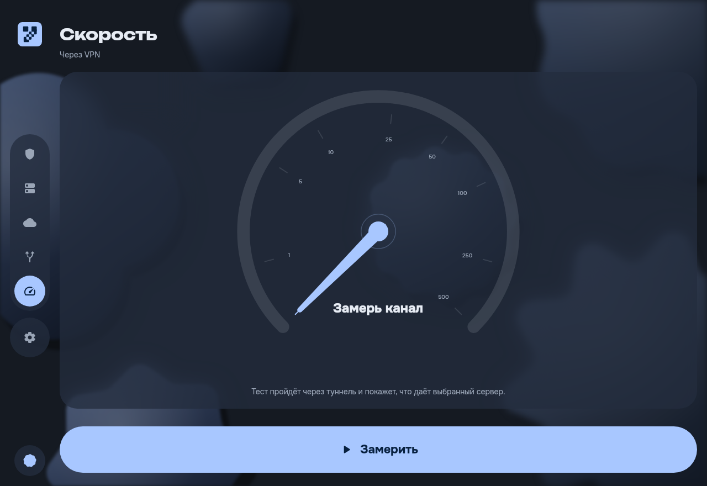

# Yumi Desktop

> **Beta.** It works, it is used daily, and it has not been through many hands yet. The tunnel
> service runs with system privileges, so read what it does below before you install it, and
> expect the rough edges of something young.

The Windows port of Yumi — a VPN client for Xray-family servers, built to look and behave like the
phone and television versions rather than like a settings dialog.

* **Connect screen** — a poster headline that says what the tunnel is doing, a figure that shows
  what it is carrying (a scrolling pixel map of the world, or the traffic waves), and one loud
  control under it.
* **Servers** — a grid of cards with the protocol, the transport details that actually change
  behaviour, and a latency reading you can act on.
* **Subscriptions** — quota, expiry and refresh, or a QR transfer from Yumi on your phone over the
  local network.
* **Split tunnelling** — by application, domain or subnet, either direction.
* **Speed test** — a dial and a live trace, through the tunnel or around it.
* **Seven pastel palettes**, light and dark, plus AMOLED black.

| | |
|:-:|:-:|
|  |  |
|  |  |

Taken with `--ui-smoke`, which walks every screen against a stub service that cannot connect —
hence the connection screen saying so.

Protocols come from Xray: VLESS (including REALITY and Vision), VMess, Trojan, Shadowsocks,
Hysteria2, TUIC and the rest of the outbound catalogue, over TCP, WebSocket, gRPC, HTTP/2,
HTTPUpgrade or QUIC.

## Requirements

Windows 10 version 1809 (build 17763) or newer, 64-bit. Nothing else: the installer brings its own
Java runtime and its own network adapter driver.

## Installing

Run `Yumi-Desktop-<version>-windows-x64-setup.exe` and accept the elevation prompt. The installer:

1. copies the application into `Program Files\Yumi Desktop`;
2. registers `YumiTunnel`, the Windows service that owns the tunnel, and starts it;
3. adds one inbound firewall rule, scoped to the local subnet on private and public networks, so a phone can
   hand a subscription over by QR.

The installer is not code-signed, so SmartScreen will offer to protect you from it. "More info"
then "Run anyway" is the way past that.

Uninstalling removes the service, the firewall rule and the startup entry. Your subscriptions and
settings live in `%LOCALAPPDATA%\YumiDesktop` and are left alone, so reinstalling keeps them; delete
that folder by hand if you want them gone.

## How it is split

The application never touches the network stack. It talks to a local service over a named pipe,
and the service is the only thing that holds the tunnel:

| Module     | What it is                                                                   |
|------------|------------------------------------------------------------------------------|
| `desktop`  | The Compose UI, the window, the tray icon.                                    |
| `logic`    | Parsing, subscriptions, latency and speed measurement, the Xray config. Shared, unchanged, with the Android app. |
| `platform` | The Windows-shaped parts: the registry, the named pipe, the title-bar colour. |
| `service`  | The Go service: Wintun, Xray-core, and the pipe protocol. Runs as `YumiTunnel`. |

The service accepts commands from exactly one Windows account — the owner's SID is baked into its
configuration — and does nothing at all until the application asks it to connect.

That account is the one that was signed in when the installer ran, not the one that answered the
elevation prompt. On a machine where those differ, the service would otherwise be owned by an
administrator who never opens Yumi, and the person who does would be refused by a service that
`services.msc` reports as running perfectly. If it happens anyway — the account was renamed, or a
second person uses the machine — the connect screen says so in as many words and offers to
re-register the service, which costs one elevation prompt.

The firewall rule covers the public network profile as well as the private one, and stays scoped
to the local subnet. Private-only is the safer setting on paper and it made subscription transfer
not exist on laptops: Windows marks a new Wi-Fi network public by default, so the rule never
applied and the phone's connection was dropped without a word. The domain profile is deliberately
left out.

When a tunnel will not start, what the worker said on its way down is in
`%ProgramData%\Yumi Desktop\worker.log` — a Go panic, a Wintun driver that would not load, the
core's own complaint. The file is truncated rather than rotated once it passes a megabyte.

How much the core writes there follows **Settings → log level**, which defaults to a level that
names failures and nothing else. Two things are worth knowing before raising it: the file is
readable by any account on the machine, and at *Info* and above the core records the destination
of every connection it makes. Where the log is written is not the application's to choose — the
service decides that, and only the volume crosses the pipe.

## When it says connected and nothing loads

The service reports `connected` when the core has started: the adapter exists, the routes were
accepted. Whether the machine then *uses* that tunnel is a different question, and on Windows the
usual reason it does not is another VPN client. They leave their TUN adapter behind when switched
off, holding the resolver and a default route, and a fake-ip client answers every name with an
address from `198.18.0.0/15` that means nothing outside its own tunnel.

So shortly after connecting, Yumi asks two questions: one through its own probe inbound, which
reaches the server without touching a local resolver, and one as any other program on the machine
would. Server yes and machine no is the interesting answer, and the connect screen says which of
the three it got. Nothing is disconnected automatically — the tunnel is fine; it is the machine
around it that is not using it.

## Building

You need a JDK 21, Go 1.26 and the two verified downloads that `bootstrap.ps1` fetches (Wintun and
Inno Setup). Then:

```powershell
$env:JAVA_HOME = 'C:\path\to\jdk-21'
./tools/bootstrap.ps1                 # once: Wintun and the installer compiler
./tools/build.ps1 -GoExe 'C:\path\to\go1.26\bin\go.exe'
```

`build.ps1` runs the JVM and Go test suites, builds the service, builds the application image,
collects every dependency's licence, compiles the installer into `dist/` and prints its SHA-256.
Pass `-SkipTests` when you are iterating.

To run the application alone, without the service — every screen works, only connecting does not:

```powershell
./gradlew.bat :desktop:run
```

`./gradlew.bat :desktop:run --args="--ui-smoke"` walks every screen in both themes and writes
screenshots to `.local/screenshots`, against a stub service that can never connect.

## Licence

GPL-3.0-or-later; see `LICENSE`. Everything else that ships is listed in `THIRD_PARTY.md`.
