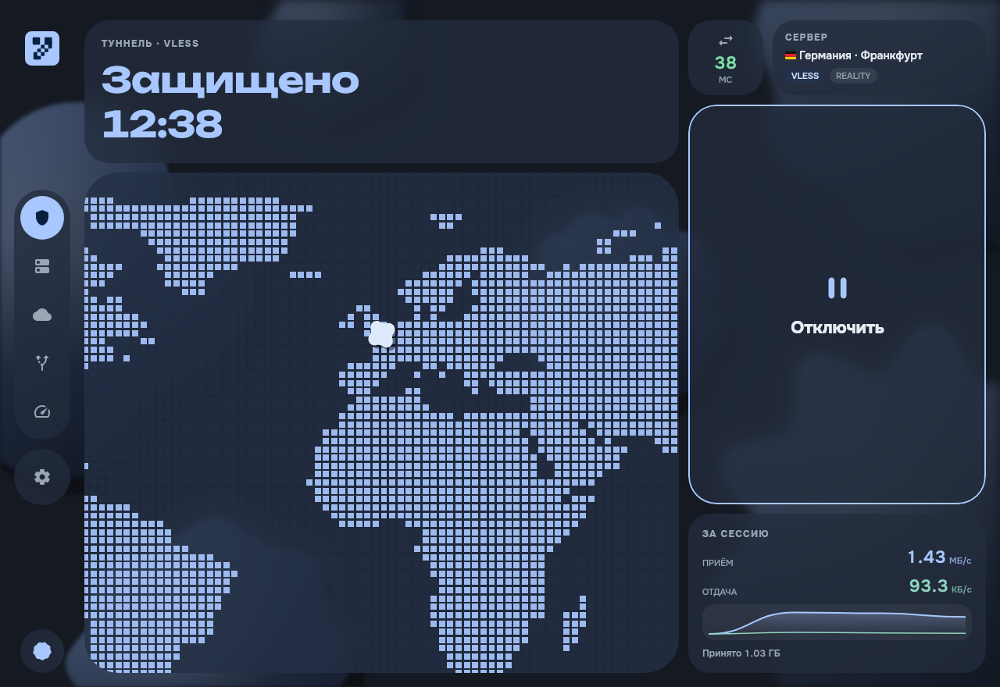
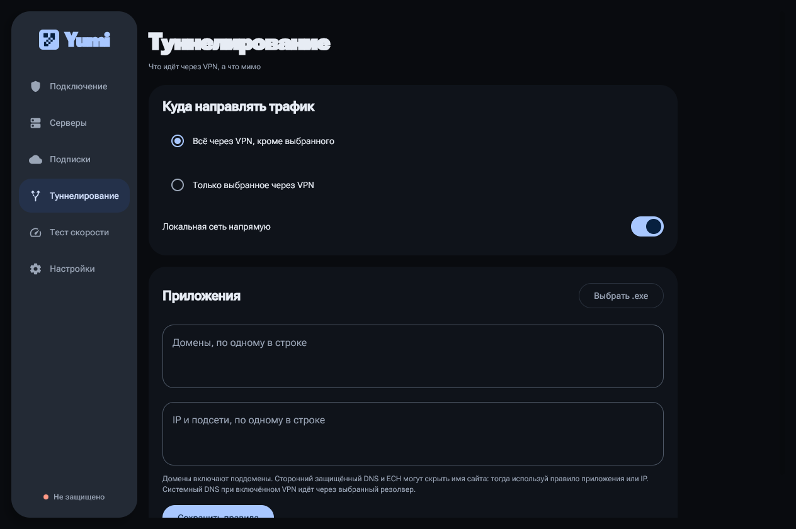
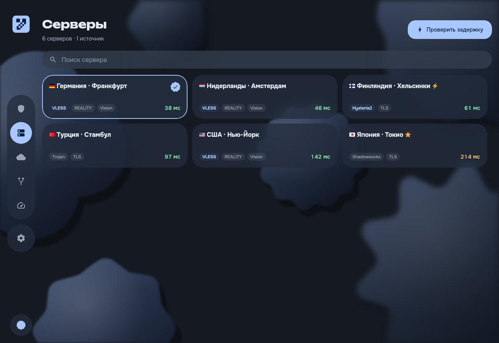
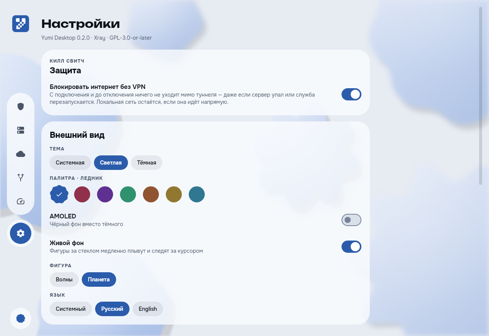

# Yumi Desktop

[English](README.md) · [Русский](README.ru.md)

> Служба туннеля работает с системными привилегиями; её обязанности и контроль доступа
> описаны ниже.

Десктопный порт Yumi — VPN-клиента для серверов семейства Xray — в матовом стекле
родственного приложения YouCloud: за окном плывут фигуры Material 3 Expressive, каждая панель
покрыта матовым стеклом поверх них, а при перетаскивании окна они покачиваются на пружинках.

* **Экран подключения** — крупный заголовок с состоянием туннеля, фигура, отражающая передачу
  данных (прокручиваемая пиксельная карта мира или волны трафика), и одна большая кнопка рядом.
* **Серверы** — читаемый список с протоколом и транспортом, источником, выбором и пингом в
  каждой строке. При подключении активный туннель измеряется сразу. Пинг проверяет только
  текущие результаты поиска; сам поисковый запрос сохраняется при переходе между экранами. Строки
  серверов никогда не меняются сами по себе. Группы автовыбора Happ сохраняют всех участников и
  работают по политике провайдера (`cost`/`fastest`), как в мобильной версии.
* **Трей** — один клик возвращает окно; меню трея переключает серверы, показывает пинг и
  обновляет задержку, не открывая приложение.
* **Проверка соединения** — защита отображается только после того, как туннель пропустил
  подтверждённый запрос. О недоступном сервере сообщается даже тогда, когда локальное ядро ещё
  работает; проверки продолжаются до восстановления.
* **Подписки** — трафик, срок действия и обновление, а также перенос подписки по QR с телефона с
  Yumi по локальной сети.
* **Туннелирование** — выбор приложений из списка запущенных и установленных, с их иконками,
  либо ввод имени процесса (как в Clash); правила для доменов и подсетей в любую сторону.
* **Российские сайты напрямую** — базы `geoip`/`geosite`, которые служба скачивает сама, пускают
  российские сайты в обход туннеля *поверх* правил приложений: браузер, полностью отправленный в
  VPN, всё равно откроет их напрямую. YouTube при этом остаётся в туннеле.
* **Килл свитч** — с момента подключения и до явного отключения ни один пакет не уходит мимо
  туннеля, даже если упадёт сервер или само ядро.
* **Местоположение — как у сервера (для Claude и других сервисов со строгой проверкой региона)** —
  пока VPN подключён, Yumi скрывает реальное местоположение глубже одного только выходного IP:
  системная таймзона переезжает в страну выбранного сервера (и обновляется на лету при смене
  сервера), системные источники геолокации замолкают (`lfsvc` и политики на Windows, `GeoClue` на
  Linux, `locationd` на macOS), DNS-запросы запираются в туннеле, а IPv6 при выключении
  блокируется — благодаря этому сайты и приложения вроде Claude видят согласованные IP, часы и
  геолокацию. Опция выключена по умолчанию в Настройках; перед изменением делается снимок состояния
  на диск, а на отключении или после сбоя всё возвращается обратно. При этом не синтезируются
  GPS-координаты и не очищается кэш местоположения в браузере. См. [Скрытие реального
  местоположения](#скрытие-реального-местоположения).
* **Тест скорости** — шкала и живой график, через туннель или напрямую.
* **Пятнадцать палитр**, светлая и тёмная темы, а также чёрный режим AMOLED; шрифты Unbounded и
  Onest, как в YouCloud.
* **Подключать VPN при запуске**, по желанию, к выбранному серверу; выключено по умолчанию в
  Настройках.
* **Обновления в Настройках** — фоновая проверка и верифицированная загрузка, прогресс и отмена,
  затем перезапуск сейчас или установка при выходе. Каждая ОС запрашивает собственные права на
  замену приложения и службы.

| | |
|:-:|:-:|
|  |  |
|  |  |

Скриншоты сняты с флагом `--ui-demo`, который подставляет тестовые серверы и запускает все экраны
поверх заглушки службы, имитирующей подключение.

Протоколы работают на базе Xray: VLESS (включая REALITY и Vision), VMess, Trojan, Shadowsocks,
Hysteria2, TUIC и остальной каталог исходящих подключений поверх TCP, WebSocket, gRPC, HTTP/2,
HTTPUpgrade и QUIC.

## Требования

Windows 10 версии 1809 (сборка 17763) или новее, 64-бит. Больше ничего не требуется: установщик
несёт собственный Java runtime и драйвер виртуального сетевого адаптера.

Linux (x86-64, systemd; `.deb` и `.rpm`) и macOS 12 или новее на Apple Silicon (`.dmg` для
установки, `.pkg` для автообновления) обладают тем же набором возможностей: туннель, килл свитч,
раздельное туннелирование, гео-базы, подписки, режим местоположения. См. [Linux и
macOS](#linux-и-macos).

## Установка

Запустите `Yumi-Desktop-<version>-windows-x64-setup.exe` и подтвердите запрос прав
администратора. Установщик:

1. копирует приложение в `Program Files\Yumi Desktop`;
2. регистрирует `YumiTunnel` — службу Windows, владеющую туннелем — и запускает её;
3. добавляет одно входящее правило брандмауэра в пределах локальной подсети для частных и публичных
   сетей, чтобы телефон мог передать подписку по QR.

Установщик не имеет цифровой подписи, поэтому SmartScreen предложит защитить систему. Чтобы
продолжить, нажмите «Подробнее» и затем «Выполнить в любом случае».

Удаление программы удаляет службу, правило брандмауэра и запись автозапуска. Ваши подписки и
настройки хранятся в `%LOCALAPPDATA%\YumiDesktop` и остаются нетронутыми, поэтому при
переустановке они сохраняются; если нужно удалить их полностью, сотрите эту папку вручную.

## Linux и macOS

Установите пакет привычным для дистрибутива способом — `dpkg -i`, `rpm -U` или двойным кликом по
`.dmg` на macOS — и запустите Yumi. При установке служба туннеля не регистрируется: первое
подключение один раз запрашивает пароль администратора (`pkexec` на Linux, системный диалог на
macOS), регистрирует `yumi-tunnel.service` в systemd или демона в launchd, и дальше служба владеет
туннелем точно так же, как `YumiTunnel` на Windows — тот же протокол, те же команды, unix-сокет
`/run/yumi/tunnel.sock` вместо именованного канала. Привилегированный бинарник копируется в
`/usr/local/libexec/yumi-desktop` на Linux или `/Library/PrivilegedHelperTools` на macOS, отдельно
от бандла приложения. Обновление приложения переустанавливает и перезапускает этот helper.

* **Килл свитч** — таблица nftables на Linux и anchor `pf` на macOS; устанавливается до старта ядра
  и снимается при отключении. Разрешает собственную учётную запись службы, а не отдельный
  бинарник — nftables и pf фильтруют по владельцу, а не по программам — поэтому системные root-процессы
  ходят напрямую наравне с туннелем, а пользовательский трафик, ради которого и работает щит, не
  пропускается.
* macOS использует существующий hook `com.apple/*` в PF; нестандартный набор правил без этого hook
  явно отклоняется как неподдерживаемый, а не перезаписывается. Включение килл свитча один раз
  сбрасывает старые состояния PF; горячая замена сохраняет текущие соединения.
* **Системный резолвер** на время подключения направляется в туннель (`resolvectl`, если работает
  systemd-resolved, `/etc/resolv.conf` с резервной копией, если нет, и `networksetup` на macOS) и
  возвращается обратно на выходе. Исходное состояние сохраняется до первого изменения и
  восстанавливается даже после частичных ошибок или падения воркера.
* **Местоположение — как у сервера** переводит часы через `timedatectl` или `systemsetup` и
  заглушает GeoClue или locationd, восстанавливая оба компонента по заранее сохранённому снимку.
* Пакеты не имеют цифровой подписи. При первом запуске на macOS сработает Gatekeeper: кликните
  правой кнопкой по приложению и выберите «Открыть». Брандмауэр приложений может один раз спросить
  о входящем подключении для переноса подписки с телефона.

Честные ограничения: для иконки в трее на Linux нужна оболочка с поддержкой AppIndicator (в GNOME
без расширения приложение сообщает об этом и закрывается по крестику вместо сворачивания в трей),
а сборка macOS выпускается только под Apple Silicon.

## Архитектура и разделение

Само приложение никогда не трогает сетевой стек. Оно общается с локальной службой по именованному
каналу (или unix-сокету), и только служба держит туннель:

| Модуль     | За что отвечает                                                              |
|------------|------------------------------------------------------------------------------|
| `desktop`  | Интерфейс на Compose, окно, иконка в трее.                                   |
| `logic`    | Разбор конфигураций, подписки, измерение задержки и скорости, сборка конфига Xray. Общий код с Android-приложением. |
| `platform` | Платформенная часть: реестр, именованный канал и его unix-аналог, цвет заголовка окна, каталог приложений. |
| `service`  | Служба на Go: адаптер туннеля, Xray-core и протокол команд. На Windows работает как `YumiTunnel`, на других ОС — как `yumi-tunnel` под systemd или launchd. |

Служба принимает команды ровно от одной учётной записи — SID владельца на Windows или uid владельца
на Linux/macOS, зашитого в её конфигурацию — и не делает ничего, пока приложение не попросит
подключиться.

На Windows это та учётная запись, под которой пользователь вошёл в систему при запуске
установщика, а не та, от имени которой был подтверждён запрос UAC. На машине, где они различаются,
служба иначе принадлежала бы администратору, который не запускает Yumi, а реальный пользователь
получал бы отказ от службы, которая в `services.msc` выглядит идеально работающей. Если это всё же
случилось — учётную запись переименовали или за компьютером работает другой человек — экран
подключения прямо сообщает об этом и предлагает перерегистрировать службу за один запрос UAC.

Правило брандмауэра охватывает как публичный, так и частный профиль сети и ограничено локальной
подсетью. Только частный профиль безопаснее на бумаге, но на ноутбуках он ломал перенос подписки:
Windows по умолчанию помечает новые сети Wi-Fi как публичные, из-за чего правило не срабатывало и
подключение с телефона молча сбрасывалось. Профиль домена намеренно не затрагивается.

Переключение серверов сохраняет стек пересылки живым и переподключает VPN-потоки через выбранный
сервер. Существующие прямые соединения при этом сохраняются. Таймер сеанса и счётчики трафика не
сбрасываются. Выключение VPN завершает VPN-соединения и направляет новый трафик напрямую; адаптер
остаётся в режиме прямой пересылки, чтобы исключённые приложения не теряли открытые сокеты.
Остановка службы Windows удаляет маршруты адаптера и закрывает этот стек. Изменение правил
маршрутизации, DNS, MTU, IPv6 или физического адаптера всё ещё требует пересборки стека.
Соединение, чей удалённый сервер уже умер, нельзя перенести на другой сервер без переподключения.

Настройки туннеля применяются с первого же подключения и сразу после сохранения изменений.
Изменения, сохранённые во время подключения, применяются сразу после старта воркера. На Windows
отдельная динамическая сессия WFP ограничивает TCP/UDP DNS только резолвером туннеля — даже при
выключенном килл свитче и включённом обходе локальной сети. Она не даёт системе уходить в DNS
физического адаптера и очищает системный DNS-кэш при включении и снятии. Ограничение снимается при
отключении VPN или завершении воркера; настройки физического адаптера при этом не переписываются.
Зашифрованный DNS, управляемый самим браузером, подчиняется настройкам и маршрутизации браузера.

### Килл свитч

Когда килл свитч включён, служба устанавливает фильтры Windows Filtering Platform в момент
подключения: блокируется всё, кроме адаптера туннеля, самой службы (которая ведёт туннель и всё,
что идёт в обход него), loopback, DHCP и — если включено «Локальная сеть напрямую» — частных
диапазонов адресов, чтобы продолжали работать принтеры и перенос с телефона. Фильтры остаются
активными при падении ядра или обрыве сервера и снимаются только по отключению. Они живут в
динамической сессии, поэтому при падении самой службы Windows удаляет их автоматически: сбой
может забрать килл свитч, но никогда не оставит машину без сети.

### Скрытие реального местоположения

Сервисы со строгой проверкой региона — например Claude — нередко смотрят не только на выходной IP,
но и на часовой пояс системы, системные API геолокации (триангуляцию по Wi-Fi), утечки DNS и
трафик IPv6. Yumi объединяет режим **Местоположение — как у сервера** (Настройки → Защита, по
умолчанию выключен) со встроенными механизмами защиты туннеля от утечек:

* **Синхронизация системной таймзоны** — считывает двухбуквенный код страны из флага в названии
  выбранного сервера и после подключения выставляет соответствующий часовой пояс через `tzutil`
  (Windows), `timedatectl` (Linux) или `systemsetup` (macOS). При горячем переключении на сервер в
  другой стране таймзона меняется на лету без перезапуска туннеля; серверы без флага оставляют
  текущие часы, но по-прежнему отключают геолокацию. В Настройках показывается текущая системная
  таймзона.
* **Отключение системных источников геолокации** — не даёт сайтам и приложениям определять ваше
  реальное положение по сетям Wi-Fi пока активен VPN:
  * **Windows**: выставляет политики `DisableLocation` и `DisableWindowsLocationProvider` в ветке
    `HKLM\SOFTWARE\Policies\Microsoft\Windows\LocationAndSensors` и останавливает службу `lfsvc`.
  * **Linux**: маскирует на время сеанса (`mask --runtime`) и останавливает `geoclue.service`.
  * **macOS**: отключает и выгружает `com.apple.locationd`.
* **Атомарный снимок и аварийное восстановление** — до первого изменения служба сохраняет на диск
  снимок исходного состояния (`sysstate.json` с прежней таймзоной, точными значениями/типами/фактом
  отсутствия политик и состоянием служб геолокации) и фиксирует целевую таймзону ещё до вызова
  системной команды. Отключение, завершение воркера и старт службы после сбоя точно возвращают всё
  на место, не затирая уже существующие политики администратора или заранее выключенные службы.
* **Защита от утечек DNS и IPv6** — DNS-запросы туннеля идут через заданный резолвер (по
  умолчанию DoH `https://1.1.1.1/dns-query`, либо TCP/UDP/IP). На Windows динамическая сессия WFP
  блокирует TCP/UDP порт 53 ко всем резолверам, кроме туннельного (`172.31.255.2`), закрывая
  откат на DNS физического адаптера или роутера даже при выключенном килл свитче и обходе LAN, а
  также сбрасывает кэш DNS. На Linux и macOS системный резолвер переводится в туннель и
  восстанавливается по снимку. При выключенном IPv6 (по умолчанию) Xray не создаёт IPv6-маршруты и
  блокирует `::/0` через `blackhole`.
* **Чистое переключение серверов и приоритет правил** — смена сервера закрывает старые
  VPN-соединения, чтобы браузеры и десктопные приложения заново открыли сокеты через новый узел;
  килл свитч (опционально) не даёт трафику просочиться мимо при сбое ядра, а пользовательские
  правила доменов имеют приоритет над базой обхода российских сайтов.

Честные ограничения: этот режим не подменяет GPS-координаты, не меняет отпечаток браузера и не
стирает уже закэшированные браузером геоданные или cookie; встроенный в браузер DoH продолжает
следовать настройкам и правилам маршрутизации самого браузера.

### Базы маршрутизации

`geoip.dat` и `geosite.dat` загружаются из релизов v2fly, которые использует мобильная версия Yumi.
Служба скачивает их сама — приложение лишь даёт команду, не указывая ни URL, ни путь — проверяет
опубликованную контрольную сумму и хранит базы в `%ProgramData%\Yumi Desktop\geo`, куда могут
писать только SYSTEM и администраторы. Базы загружаются автоматически при первом запуске, если их
нет, и повторно по кнопке обновления. Пока их нет, правило молчит и не влияет на трафик.

Правила применяются в следующем порядке: указанные вами домены и подсети, затем гео-базы, затем
приложения, затем правило по умолчанию. Указанный вручную сайт сильнее баз — так можно вернуть
отдельный российский ресурс обратно в VPN; базы же сильнее правил для приложений.

Если туннель не запускается, вывод воркера сохраняется в `%ProgramData%\Yumi Desktop\worker.log`
— паника Go, отказ драйвера Wintun или ошибка самого ядра. После превышения одного мегабайта файл
усекается, а не ротируется.

## Сборка

Нужны JDK 21, Go 1.26 и две верифицированные загрузки, которые скачивает `bootstrap.ps1` (Wintun и
Inno Setup). Далее:

```powershell
$env:JAVA_HOME = 'C:\path\to\jdk-21'
./tools/bootstrap.ps1                 # один раз: Wintun и компилятор установщика
./tools/build.ps1 -GoExe 'C:\path\to\go1.26\bin\go.exe'
```

`build.ps1` прогоняет тесты JVM и Go, собирает службу, собирает образ приложения, собирает
лицензии всех зависимостей, компилирует установщик в `dist/` и выводит его SHA-256. При быстрой
итерации можно передать `-SkipTests`.

Запустить только графическое приложение без службы (работают все экраны, кроме реального
подключения):

```powershell
./gradlew.bat :desktop:run
```

`./gradlew.bat :desktop:run --args="--ui-smoke"` проходит все экраны в обеих темах и сохраняет
скриншоты в `.local/screenshots` на заглушке службы; `--ui-demo` делает то же самое с тестовыми
серверами и имитацией подключения. Можно добавить `--ui-idle` (остаться в отключённом состоянии),
`--ui-size=680x600` (проверить компактную раскладку) или `--ui-resize` (снять оба перехода
размера). Шесть страниц делят общую сетку заголовка и отдельные фиксированные островки навигации;
в компактном окне половина ширины над картой отдана кнопке подключения.

`--ui-preview` открывает интерактивное демо без обхода скриншотов. `--ui-benchmark` создаёт 600
тестовых серверов и замеряет реальный рендер Direct3D: планету, волны, две скорости прокрутки,
статичный фон и трей. При запуске через Gradle результаты попадают в
`desktop/.local/performance/benchmark.tsv`. Эти режимы используют изолированные данные и никогда
не поднимают настоящий туннель. См. [`docs/performance.md`](docs/performance.md) (раннее сравнение
на Windows) и [`docs/ui-performance-2026-11-13.md`](docs/ui-performance-2026-11-13.md) (текущая
раскладка, оптимизации рендера, проверки и границы измерений).

Автообновления работают в собранных пакетах: проверка через 15 секунд после запуска и затем каждые
четыре часа. Установленная копия скачивает новейший числовой релиз (включая опубликованные беты
Yumi), проверяет размер и опубликованный SHA-256 и предлагает установку. Переключатель **Обновлять
автоматически** управляет фоновой проверкой/загрузкой и установкой при выходе; ручная проверка
остаётся доступной всегда. Сборка из исходников или portable-версия открывает страницу релиза.
Профили и настройки сохраняются в текущем каталоге данных.

Для проверки внешнего вида и возобновления анимации
`:desktop:run --args="--ui-demo --ui-resume --ui-palettes"` скрывает и восстанавливает окно с
визуализатором волн, а затем снимает все палитры в светлом, тёмном и AMOLED-режимах. Текущий
список задач и статус проверок — в `TODO.md`.

Каждый push собирает установщик в GitHub Actions (`.github/workflows/installer.yml`) точно так же,
как `build.ps1`, вместе с тестами, и сохраняет его в артефактах. Отправка тега `v<version>` также
прикрепляет сборки и их SHA-256 к релизу.

## Лицензия

GPL-3.0-or-later; см. `LICENSE`. Все сторонние компоненты перечислены в `THIRD_PARTY.md`.
