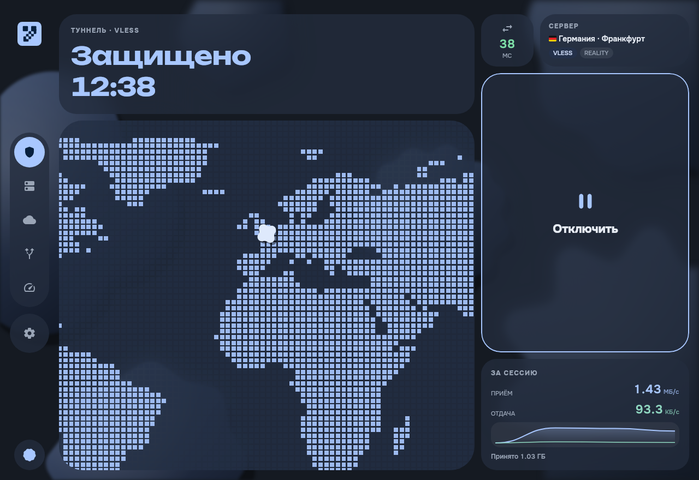
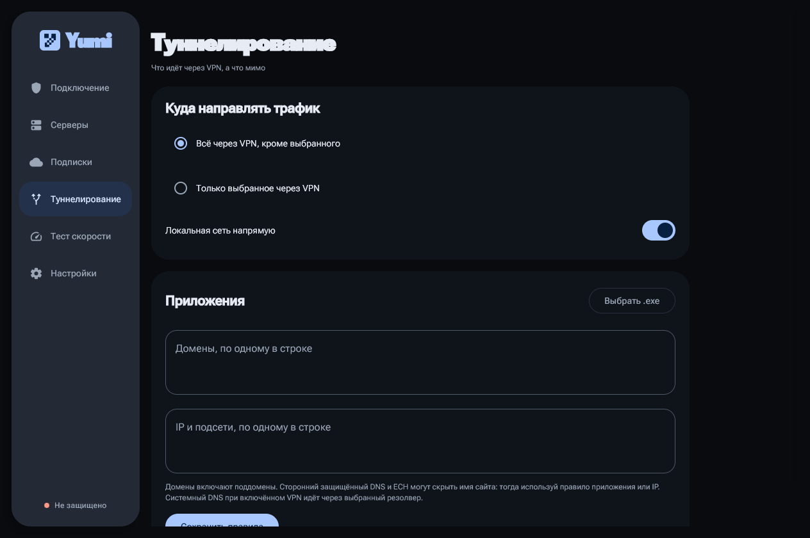
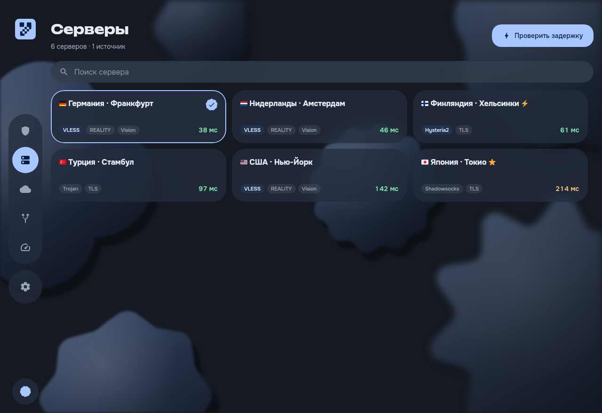
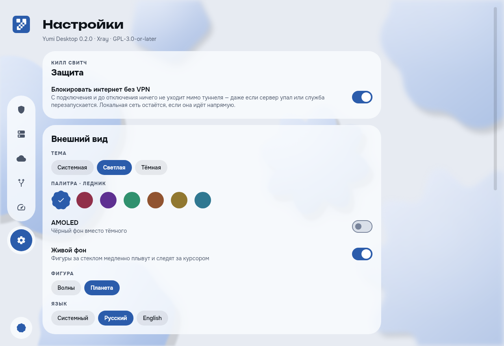

> **Это бета.** Килл свитч и маршрутизация по базам в этой версии новые и через много машин ещё не
> прошли. Туннель держит служба Windows с системными правами — ниже написано, что она делает.

Yumi на Windows в матовом стекле YouCloud: за окном плывут фигуры Material 3 Expressive, все панели —
матовое стекло поверх них, а если двигать окно, фигуры по инерции раскачиваются на пружинах.

### Что нового

* **Килл свитч.** С подключения и до отключения ничего не уходит мимо туннеля — даже если сервер
  упал или ядро перезапускается. Локальная сеть остаётся, если она идёт напрямую. Включается в
  настройках; если туннель лёг, на экране подключения будет кнопка «Снять блокировку».
* **Российские сайты напрямую.** Базы geoip/geosite служба скачивает сама при первом запуске и по
  кнопке. Они работают поверх правил приложений: браузер, целиком отправленный в VPN, всё равно
  открывает российские сайты напрямую. YouTube остаётся в туннеле.
* **Удобный выбор приложений.** Список запущенных и установленных программ с иконками и поиском —
  или вписать имя процесса, как в Clash (`telegram.exe`), и нажать Enter. Старые правила с путями
  к .exe превратятся в имена сами.
* **Новый интерфейс.** Шрифты Unbounded и Onest, матовое стекло вместо плоских карточек, док из
  круглых кнопок вместо боковой панели, матовая карта. «Живой фон» выключается в настройках.
* **Исправления из Android-версии,** которые не были собраны в прошлый установщик: подписки с
  группами автовыбора, полузакрытые соединения больше не рвутся через секунду, трафик в
  собственную подсеть туннеля не гоняется по кругу.
* Сервер по-прежнему меняется только по твоему выбору — автосмены нет.

### Что нужно

Windows 10 версии 1809 (сборка 17763) или новее, 64-разрядная. Больше ничего: установщик несёт
собственную среду Java и собственный драйвер сетевого адаптера.

### Как поставить

1. Скачай `Yumi-Desktop-0.2.0-windows-x64-setup.exe` и запусти поверх старой версии — подписки и
   настройки сохранятся. Согласись на повышение прав.
2. Установщик не подписан сертификатом, поэтому SmartScreen предложит тебя защитить.
   «Подробнее» → «Выполнить в любом случае».
3. Приложение запустится само. Базы маршрутизации докачаются в течение минуты.

### Как проверить новое

Списком — в `MANUAL-TESTS.md`, разделы «Kill switch» и «Russian sites and the databases». Коротко:
включи килл свитч, подключись, убей в диспетчере задач `yumi-service.exe --worker` — интернет
должен пропасть, а «Снять блокировку» — вернуть его. С выбранным браузером в режиме «Только
выбранное» ya.ru должен показывать российский адрес на 2ip.ru.

Если туннель не поднимается, что сказало ядро — в `%ProgramData%\Yumi Desktop\worker.log`.

### Известные шероховатости

* Установщик не подписан — SmartScreen будет ругаться на каждой новой версии.
* Драйвер адаптера собран только под x64: на ARM-ноутбуках приложение встанет, туннель — нет.
* Если килл свитч не смог включиться, туннель не поднимется и экран скажет почему — выключи его в
  настройках, чтобы подключиться без него.

---

| | |
|:-:|:-:|
|  |  |
|  |  |
